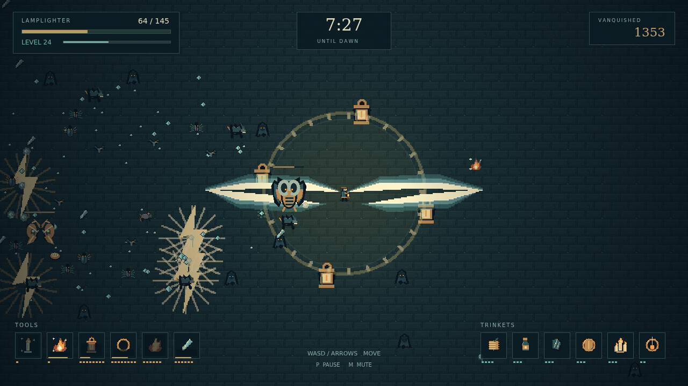

# Wick

**Keep the light.** A complete browser survival game about one lamplighter in a moth-choked city. Walk while your tools fight on their own, collect the gems left behind, and build a loadout that can last until dawn at **10:00**.

Ten tools, six evolutions, ten trinkets, thirteen enemies, and a browsable Almanac fill the night. Original pixel sprites, animated effects, fourteen sound cues, and an original looping score are included in this repository. There is no backend or external service.



## Install and play

Use Node.js 22.12 or newer.

```sh
npm ci
npm run dev
```

Open the local URL printed by Vite. Sound unlocks with your first key press or pointer interaction.

## Production

```sh
npm run build
npm run preview
```

The complete static site is in `dist/`, including `index.html` and all assets. Serve that directory at a host's root or at a sub-path such as `/wick/`. URLs are page-relative. No asset-generation program is needed to install, build, or run the published game.

## Controls

| Input | Action |
| --- | --- |
| WASD or arrow keys | Walk; up/down select menu items |
| Enter or Space | Confirm a menu choice |
| Escape | Back, or pause/resume during play |
| P | Pause/resume |
| M | Mute/unmute |
| Left/right in the Almanac | Change tabs |
| Mouse wheel in the Almanac | Scroll the entry list |
| Mouse or touch | Select and activate menus |
| Backtick | Toggle engine diagnostics |

Touch devices also receive the engine's directional controls. A press activates a menu item only when released inside the same item.

Gems raise your level and offer a choice of new tools, trinkets, or upgrades. You can carry six of each. Elite creatures leave chests: carry a tool at level eight and its matching trinket to transform it. The Almanac lists every item, enemy, pickup, and evolution recipe.

## Verification

```sh
npm run typecheck
npm run lint
npm run format
npm test
```

Tests instantiate the real Simple 2D engine with a fixed clock and a canvas, load the committed assets, and drive the simulation through its debug surface. Additional asset tests verify canvas sizes, distinct animation frames and icons, audible WAV data, loop lengths and seams, and the MIDI score.

The simulation advances at 60 ticks per second, independently of rendering. The engine owns input, frame timing, audio, asset loading, and diagnostics. Game state is a value; updates and debug poses construct a new state. `src/game.ts` exports the game and its state/debug types. No debug handle is installed on the page.

## Original assets and showcase

`assets/` contains the finished files; `public/assets` links that directory into Vite's static asset copy. The optional development scripts `tools/make_art.py` and `tools/make_audio.py` record and render original art and sound with the asset tools available in the authoring environment. They are never invoked by the production build.

`showcase/` contains the player-facing description, screenshots, and a 150-frame replay recorded by the engine. With the development server running, `node tools/capture.mjs` recreates the captures using the project-local Playwright and a posed live combat scenario. After a production build, `node tools/browser-check.mjs` checks the static site at both root and sub-path URLs in Chromium.
